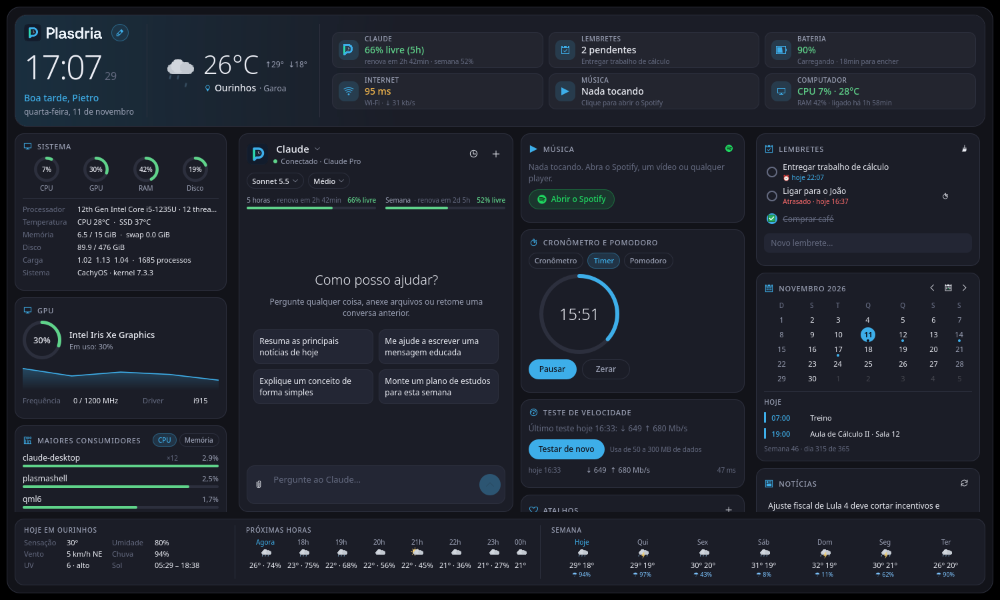
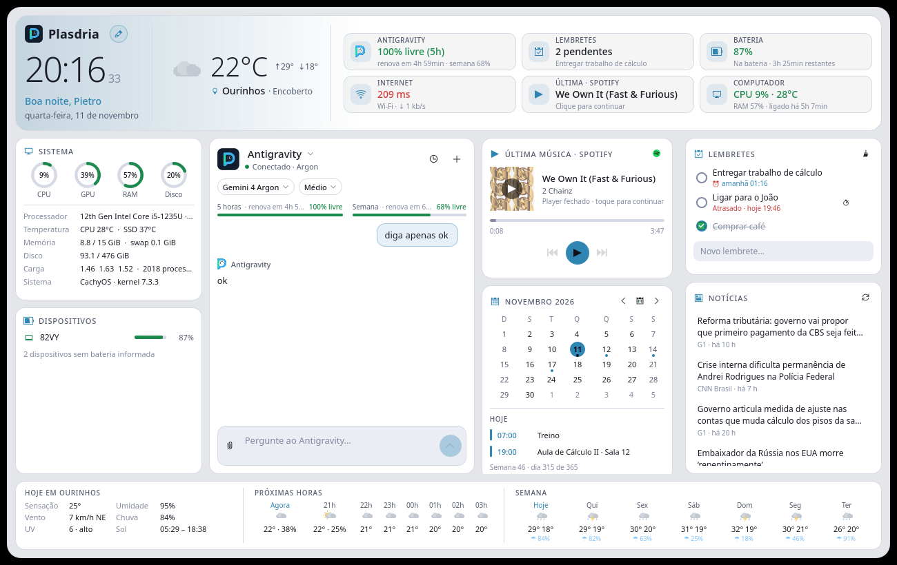

<div align="center">


**Seu assistente, sua música, sua rede e seu dia. Na área de trabalho.**

Um widget para KDE Plasma 6 com chat integrado ao **Antigravity**, **Claude** e outras IAs (**Codex**, **Gemini CLI**, **Ollama** e **APIs compatíveis com OpenAI**), música tocando agora, rede, lembretes, clima, notícias e monitoramento do sistema — em um painel escuro, responsivo e configurável.


</div>

## O que ele faz

| Cartão | Detalhes |
| --- | --- |
| **Painel geral** | A base do widget: logo do Plasdria, horário, saudação, data e clima resumido (temperatura, máxima/mínima, cidade e condição). Ao lado, um resumo do que importa agora: cota da IA ativa (clique para alternar entre IAs), lembretes pendentes, bateria, internet, música tocando (clique para pausar) e uso do computador. |
| **Rodapé do clima** | Detalhes de hoje (sensação, umidade, vento, chuva, UV e sol), as próximas horas e a semana, com chance de chuva. |
| **Chat multi-IA** | Alterne a qualquer momento entre **Antigravity** (`agy`), **Claude** (`claude`), **Codex** (`codex`), **Gemini CLI** (`gemini`), **Ollama** (modelos locais em `localhost:11434`) e **API Compatível** (OpenAI, OpenRouter, Groq, DeepSeek, LM Studio) pelo seletor no topo do chat ou com `/ia <nome>`. Se trocar de IA no meio de uma conversa, o histórico na tela é mantido e enviado como contexto para a outra IA continuar de onde parou. Respostas em tempo real e formatadas (Markdown), escolha de modelo e nível de esforço, anexos de imagens/arquivos e histórico com busca e importação de conversas. Passe o mouse sobre uma mensagem para **gerar a última resposta de novo** ou **editar uma pergunta** e refazer dali em diante (o que veio antes segue como contexto; anexos não são reenviados). |
| **Cotas** | Barras da cota de 5 horas e semanal para Antigravity (separadas por família de modelo: Gemini 4 Argon, Gemini e Claude/GPT) e Claude Code, com o tempo até renovar. O ícone do painel mostra a cota de 5 h em um anel. |
| **Música** | Qualquer player compatível com MPRIS (Spotify, YouTube no navegador, VLC, Elisa…): capa, título, artista, barra de progresso clicável, tocar/pausar, anterior, próxima, aleatório, repetir e volume. O Spotify tem prioridade e um botão para abrir. A última música fica lembrada com a capa guardada: com o player fechado ou sem internet ela continua aparecendo, e um clique abre o Spotify e retoma do ponto em que parou. |
| **Rede** | Nome da rede, sinal do Wi-Fi, IP local, latência e gráfico de download/upload em tempo real. |
| **Lembretes** | Lista rápida com marcar como feito, remover e limpar concluídos. Escreva o horário na frase (“ligar para o João **amanhã 9h**”, “remédio **em 20 min**”, “dentista **sexta 14h30**”) e o lembrete vira um **alarme**: o Plasdria avisa com uma notificação do sistema na hora, mesmo com o painel fechado, e dá para adiar 10 minutos. Os eventos da agenda também avisam alguns minutos antes (configurável, 10 por padrão). Fica salva nas configurações do widget. |
| **Sistema** | CPU, GPU, RAM e disco em anéis com cores por nível de uso, mais processador, temperaturas da CPU e do SSD, memória e swap, carga, processos, tempo ligado, bateria e versão do sistema. |
| **Calendário** | Mês atual com navegação, hoje destacado, semana do ano e dia do ano. Com o link iCal da sua agenda (Google Agenda, Nextcloud, Outlook…), mostra pontinhos nos dias com compromissos e a agenda do dia que você tocar, incluindo eventos que se repetem. |
| **Dispositivos** | Bateria do notebook e de periféricos que publicam essa informação (UPower/BlueZ). |
| **Áudio e brilho** | Volume (arraste ou toque na barra), silenciar, escolha da saída de áudio (alto-falantes, fone…, levando junto o que já está tocando) e brilho da tela. Usa o PipeWire/PulseAudio (`pactl`); o brilho é ajustado pelo logind, sem root. |
| **Bluetooth** | Liga e desliga o Bluetooth e lista os dispositivos pareados com estado e bateria; um toque conecta ou desconecta. |
| **Maiores consumidores** | Os programas que mais usam CPU e memória, somando os processos de cada um (um navegador com 12 processos vira uma linha). Só mede enquanto o cartão está na tela. |
| **GPU** | Nome da placa, uso (com histórico), frequência, temperatura e memória, conforme o driver informar: Intel (i915/xe), AMD (amdgpu) e NVIDIA (`nvidia-smi`). O anel de GPU do cartão Sistema usa a mesma leitura. |
| **Atalhos** | Aplicativos instalados, sites e pastas com um toque. Só abre apps, endereços http/https/mailto, arquivos e pastas: nunca comandos de terminal. |
| **Teste de velocidade** | Mede latência, jitter, download e upload com os servidores públicos da Cloudflare (`speed.cloudflare.com`), com velocidade ao vivo, barra de progresso e histórico dos últimos testes. **Só roda quando você toca em Iniciar** e usa de 50 a 300 MB de dados, conforme a conexão. Nada é enviado além dos dados de teste: nenhum IP ou identificação é guardado. |
| **Cronômetro e pomodoro** | Cronômetro com voltas, timer (1 a 600 min) e pomodoro (foco, pausa curta e longa depois de 4 focos, com contagem do dia). O motor roda no widget e avisa com notificação do sistema mesmo com o cartão oculto; o estado sobrevive a reiniciar o Plasma. As durações do pomodoro são configuráveis. |
| **Resumo do dia** | Agenda de hoje, lembretes (atrasados, de hoje e sem data) e clima com dicas (guarda-chuva, calor, UV) num só cartão, montado no próprio widget, sem IA. O botão **Resumir com a IA** manda esse resumo ao chat para uma versão comentada. Uma notificação diária (a partir da hora escolhida, padrão 8 h) traz o resumo curto, com os botões **Ver resumo** e **Resumir com a IA**. |
| **Notícias** | Lista de manchetes do Google News Brasil com fonte e horário, tema configurável (Tecnologia, Esportes, Economia…). |

**Layout editável.** Clique em **✎ Editar** ao lado do logo, no topo do widget (ou clique direito → **Editar layout**) e reorganize na mão: arraste os cartões pelo nome para outra posição ou coluna, oculte o que não usa (e traga de volta pela barra), puxe as divisões entre as colunas para mudar a largura e use **Restaurar padrão** se quiser recomeçar. O arranjo fica salvo. Nos tamanhos médio e estreito a edição usa setas ▲ ▼ para mudar a ordem dos cartões.

Na primeira abertura (e depois de atualizações com cartões novos) o Plasdria mostra uma tela de **Novidades** para você escolher quais cartões quer. Eles começam ocultos no layout: clique em **✎ Editar** e toque em **＋ Nome** para colocá-los onde quiser (ou desligue-os de vez em Configurar → Cartões).





O layout se adapta ao espaço: em telas largas, o **painel geral** fica em cima e os cartões e o chat embaixo, preenchendo todo o espaço; em tamanho médio (ou quando a altura é curta), painel e cartões rolam à esquerda, em uma ou duas colunas conforme a largura, com o chat ao lado; quando estreito (como no painel do Plasma), há abas **Painel** / **Chat**.


## Configurações

Clique com o botão direito no widget → **Configurar Plasdria…**

- **Geral** — seu nome para a saudação, links iCal da agenda (um por linha), cidade (busca por nome) ou detecção automática, IA padrão (Antigravity, Claude, Codex, Gemini CLI, Ollama ou API Compatível), modelo e esforço padrão, endpoint/chave para API compatível e tema das notícias.
- **Cartões** — escolha quais cartões aparecem (a posição de cada um se edita no próprio widget).
- **Aparência** — tema escuro, claro ou do sistema (acompanha o Plasma), cor de destaque, opacidade do fundo e animações.
- **Alertas do sistema** — notificação única quando a bateria fica baixa (e não está na tomada), o disco enche, a CPU esquenta ou a internet cai (e quando volta). Cada notificação traz botões: **Silenciar 1 h** e um atalho útil (abrir o widget, **Ver maiores consumidores** para CPU quente, **Testar a conexão** para internet fora). Limites configuráveis em Configurar → Geral, 0 desliga cada um; cada aviso só repete depois que o valor se recupera.
- **Atalho global** — `Meta+Alt+P` abre o widget e leva o cursor ao campo do chat (troque em Configurar → Atalhos de teclado).
- **Exportar conversa** — o botão de salvar no topo do chat grava a conversa em Markdown (`.md`).

## Instalação

Requer Linux com **KDE Plasma 6**, compilador C++, Qt 6 (Base e Declarative), qmake, Make, Python 3 e `kpackagetool6`. Desenvolvido no CachyOS.

No CachyOS / Arch Linux:

```bash
sudo pacman -S --needed gcc make python qt6-base qt6-declarative kpackage
```

Para conversar, instale o [Claude Code](https://docs.claude.com/en/docs/claude-code) e entre com sua conta (assinatura Claude ou chave de API). Se ainda não estiver autenticado, rode `claude` e use `/login`.

Na pasta do projeto:

```bash
./install.sh
```

Depois procure **Plasdria** em **Adicionar widgets**. Ao atualizar uma instalação existente, recarregue o Plasma:

```bash
systemctl --user restart plasma-plasmashell.service
```

Para desinstalar:

```bash
kpackagetool6 -t Plasma/Applet -r local.plasdria
```

## Desenvolvimento

O projeto já vem configurado para o **VS Code** (`.vscode/`): abra a pasta e use **Terminal → Executar Tarefa…**

| Tarefa | O que faz |
| --- | --- |
| Compilar | Gera o plugin nativo e o pacote `plasdria.plasmoid` |
| Instalar no Plasma | Compila e instala/atualiza o widget |
| Testes | Compila e roda os testes: chat (Claude simulado), música (player simulado), prazos e agenda iCal, a edição do layout, os alertas, o resumo do dia, os botões das notificações (contra um servidor de notificações de mentira), as mensagens (regenerar/editar) e os cartões novos com mouse simulado, e o teste de velocidade contra um servidor local de mentira |
| Prévia (capturas) | Renderiza o widget fora do Plasma e salva PNGs em `build/preview/` |

Pela linha de comando: `./build.sh`, `./install.sh`, `bash tests/run.sh` e `qml6 tools/preview.qml -- <pasta> [--sem-rede]`.

## Como funciona

| Camada | Tecnologias |
| --- | --- |
| Interface | QML / Qt Quick, Kirigami (ícones e página de configurações) |
| Núcleo | C++17, Qt Core, Network, D-Bus e Concurrent |
| Assistente | Antigravity (`agy`), Claude Code (`claude`), Codex (`codex`), Gemini CLI (`gemini`), Ollama (`/api/chat`) e APIs compatíveis com OpenAI (`/v1/chat/completions`) |
| Música | MPRIS via D-Bus |
| Rede | `/proc/net/dev`, NetworkManager via D-Bus |
| Sistema e baterias | `/proc`, `/sys` (hwmon, backlight, drm), UPower e BlueZ; `nvidia-smi` quando disponível |
| Áudio, brilho e Bluetooth | `pactl` (PipeWire/PulseAudio), logind (brilho), BlueZ e rfkill |
| Teste de velocidade | HTTPS com `speed.cloudflare.com` (`/__down` e `/__up`), várias conexões em paralelo |
| Clima e cidades | Open-Meteo (atual, por hora, 7 dias e geocodificação) |
| Notícias | RSS do Google News Brasil |

## Consumo

Os cartões de áudio e brilho, Bluetooth, GPU e maiores consumidores só leem o sistema **enquanto estão na tela**, e tudo pausa quando o widget está recolhido em um painel. O áudio é atualizado por eventos do PipeWire/PulseAudio (`pactl subscribe`), sem consultas periódicas: com o cartão de áudio fechado são 0 chamadas ao `pactl` (eram 1 por segundo) e, com ele aberto, 1 conexão contínua.

## Dados e privacidade

- O widget usa o login de cada CLI (Antigravity, Claude Code, Codex, Gemini CLI); não há chaves de API no código. Só a **API Compatível** usa uma chave, que você informa nas configurações: o Plasdria a move para o **cofre de senhas do sistema** (KWallet/Secret Service) e esvazia o campo, pois o arquivo de configuração do Plasma pode ser lido por outros usuários do computador. Ela é enviada apenas ao endereço que você definir (prefira `https://`). Se o cofre estiver indisponível ou bloqueado, a chave continua na configuração.
- As conversas ficam nos próprios CLIs (por exemplo `~/.claude/projects` e `~/.gemini/antigravity-cli`). O Plasdria guarda só o estado de recuperação em `~/.local/share/plasdria/chat-state.json`, privado do usuário.
- **Perguntas, anexos e contexto enviados são processados pela IA escolhida** (e, ao trocar de IA no meio da conversa, o histórico na tela é reenviado como contexto para a nova). Com o Claude, o widget roda sem plugins, hooks ou servidores MCP do usuário e só libera ferramentas de leitura e busca (`Read`, `Glob`, `Grep`, `WebSearch`, `WebFetch`); nos demais, pedidos de permissão extra são recusados e o widget não usa opções que aprovam tudo automaticamente. O Ollama roda localmente.
- O teste de velocidade só acessa `speed.cloudflare.com` quando você o inicia; o histórico dos resultados fica em `~/.local/share/plasdria/speedtest.json`.
- A última música tocada fica em `~/.local/share/plasdria/media.json` e as capas em `~/.cache/plasdria/art` (no máximo 150).
- A agenda é baixada dos links iCal que você configurar (somente leitura). Esse link costuma ser secreto: também vai para o cofre de senhas do sistema e é usado apenas para baixar a agenda. Sem internet, o Plasdria continua mostrando o que já baixou até fechar.
- Os alarmes dos lembretes funcionam localmente, sem rede.
- Clima, cidades e notícias fazem consultas HTTPS. Com a cidade definida nas configurações, a localização por IP não é consultada.
- A latência é medida abrindo uma conexão com `www.google.com:443` a cada 20 segundos.

## Estrutura

```text
native/        Núcleo C++: Claude, clima/sistema, música (MPRIS) e rede
package/       Pacote do Plasma: metadados, configurações e interface QML
  contents/config/   Esquema e páginas de configuração
  contents/ui/       Cartões, chat, layout e recursos visuais
images/        Logos e ícones originais
docs/          Banner e capturas do README
tests/         Testes do chat (Claude simulado) e da música (player simulado no D-Bus)
tools/         Prévia/capturas fora do Plasma
```

## Licença

[MIT](LICENSE). Parte do núcleo (clima, sistema e histórico) vem do [PRAGUS](https://github.com/gustavoprad0/PRAGUS), também MIT. Projeto independente, sem afiliação com a Anthropic, o KDE ou os provedores de dados.
